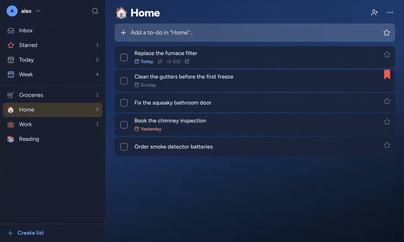
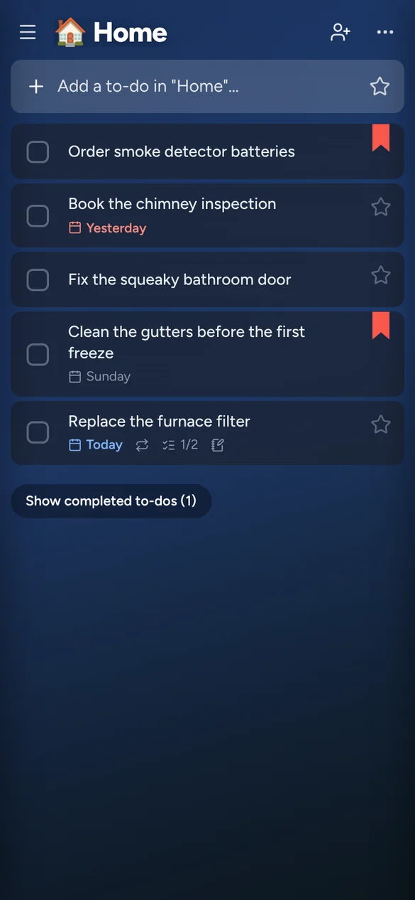
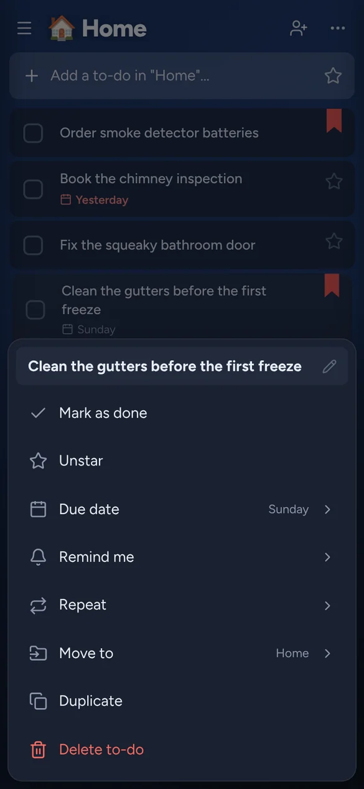
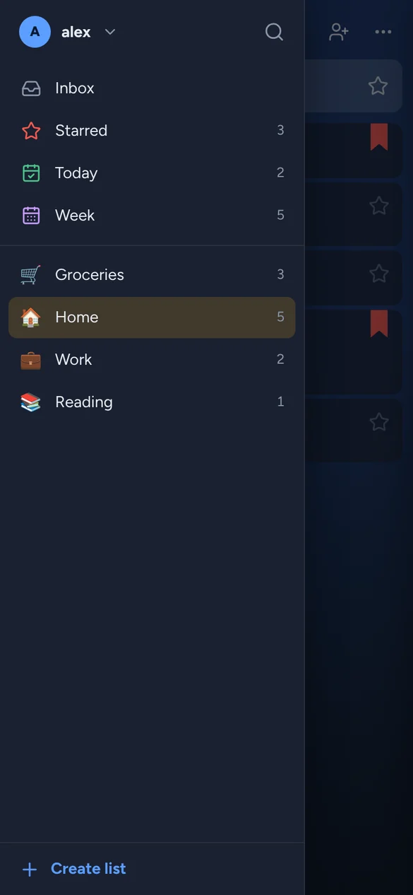
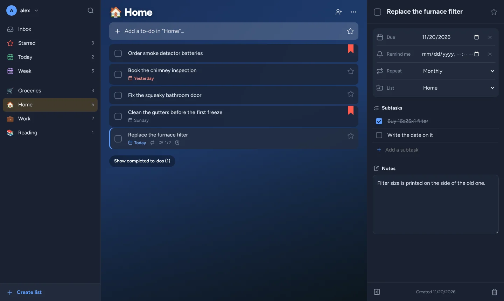

# Wunderlost

**Self-hosted to-do lists that feel like Wunderlist.** One Docker container, one SQLite file, an app on your phone.

Microsoft bought Wunderlist and shut it down, replaced it with Microsoft To Do, and is now [retiring the To Do apps on June 30, 2027](https://support.microsoft.com/en-us/planner/to-do-to-planner). Hence the name. Not affiliated with Microsoft or Wunderlist.



**Quick start**
```
mkdir -p wunderlost-data && sudo chown 1000:1000 wunderlost-data
docker run -d --name wunderlost -p 3000:3000 -e TZ=America/New_York -e VAPID_SUBJECT=mailto:you@example.com -v ./wunderlost-data:/data ghcr.io/matthornish/wunderlost:latest
docker logs wunderlost
```
Open port 3000 and enter the setup code from the log to create your admin account. For phones and push notifications, put it behind HTTPS. Full steps under [Install](#install).

<p>
  
  
  
</p>

## ⚠️ Read this first: as-is, and vibe coded

- **This was built almost entirely with an AI coding assistant (Claude)**, directed and tested by one person for their own use. It has had an AI-run security review, not a professional audit.
- **It is provided as-is, with no warranty of any kind** (see sections 15–16 of the [license](LICENSE)). There is no support commitment. It may have bugs, including security bugs. You are responsible for how you deploy it and what you put in it.
- **Don't store anything sensitive in it** — no passwords, health or financial details, or anything you couldn't stand to see leaked.
- If you expose it to the internet, put it behind HTTPS, keep registration closed, and keep the image updated.

Found a security problem? See [SECURITY.md](SECURITY.md).

## Features

- Inbox, your own lists (with emoji and colors), and smart lists: Starred, Today, Week, Assigned to me
- Subtasks, notes, due dates, repeating to-dos (daily, weekdays, weekly, every 2 weeks, monthly, yearly)
- Reminders as push notifications on phone and desktop
- Shared lists with live updates between people, and assigning to-dos
- Long-press (or right-click) menu for quick edits
- Dark, light and auto themes; scenic backgrounds or your own photo, synced across your devices
- Installs as an app on Android, iPhone/iPad and desktop (PWA)
- Multi-user, with an admin who creates accounts

## Install



You need Docker and, for push notifications and installing on phones, an HTTPS reverse proxy (Caddy, Nginx Proxy Manager, Traefik, SWAG…) with a real certificate.

**1. Create a data folder** that the container's user can write to. The image runs as `1000:1000` by default; on Unraid use `99:100` (see below).

```
mkdir -p ./wunderlost-data && sudo chown 1000:1000 ./wunderlost-data
```

**2. Run it** with Docker Compose — copy [`docker-compose.example.yml`](docker-compose.example.yml) to `docker-compose.yml`, edit `TZ` and `VAPID_SUBJECT`, then:

```
docker compose up -d
```

or plain Docker:

```
docker run -d --name wunderlost --restart unless-stopped -p 3000:3000 -e TZ=America/New_York -e VAPID_SUBJECT=mailto:you@example.com -v ./wunderlost-data:/data ghcr.io/matthornish/wunderlost:latest
```

**3. Open it and create your account.** The first time, the sign-up page asks for a **setup code**: it's printed in the container log (`docker logs wunderlost`), so nobody who stumbles on a fresh install can claim it before you. The first account becomes the admin and sign-up closes after that; add other people from **Settings → Manage users**.

**4. Put it behind HTTPS** by pointing your reverse proxy at port 3000.

### Unraid

Docker tab → **Add Container**, Advanced View:

| Field | Value |
|---|---|
| Repository | `ghcr.io/matthornish/wunderlost:latest` |
| Extra Parameters | `--user 99:100` |
| WebUI | `http://[IP]:[PORT:3000]` |
| Port | container `3000` → any free host port |
| Path | container `/data` → `/mnt/user/appdata/wunderlost` |
| Variables | `TZ`, `VAPID_SUBJECT` |

Create the appdata folder first with `mkdir -p /mnt/user/appdata/wunderlost && chown 99:100 /mnt/user/appdata/wunderlost`. Updates: **Apply Update** in the Docker tab.

## Gotchas

- **HTTPS is required** for push notifications and for installing as an app. Plain `http://` works in a desktop browser, but reminders won't push.
- **iPhone/iPad push** only works when opened from the Home Screen icon (iOS 16.4+), with a publicly trusted certificate.
- **`VAPID_SUBJECT` must be a real `mailto:` or `https:` address**, or Apple's push service rejects every notification.
- **Set `TZ`.** "Today", overdue and repeat dates use the container's timezone.
- **Permissions:** if the container can't write to `/data`, it will crash on start. Fix the folder owner to match the container user.
- **Reverse proxy and client IPs.** Sign-in limits use the client's IP from `X-Forwarded-For`, which is only trusted from proxies on loopback or private networks (the usual same-host or LAN reverse proxy). If your proxy connects from a public address, or you want it stricter, set `TRUST_PROXY` to the proxy's IP.
- **Sharing needs consent.** Only a list's owner can invite people, and the invited person has to tap **Join** before they see the list or get its reminders.
- **Live updates** use Server-Sent Events on `/api/events`. If shared-list changes only appear after a refresh, turn off response buffering for that path in your proxy.

## Configuration

| Variable | Default | Notes |
|---|---|---|
| `TZ` | system | e.g. `America/New_York` |
| `VAPID_SUBJECT` | `mailto:admin@example.com` | contact address sent to push services; set your own |
| `ALLOW_REGISTRATION` | `false` | let anyone create an account after the first (admin) one |
| `SESSION_DAYS` | `90` | how long a sign-in lasts |
| `TRUST_PROXY` | `loopback, linklocal, uniquelocal` | which proxies may set `X-Forwarded-For` ([Express trust proxy syntax](https://expressjs.com/en/guide/behind-proxies.html)) |
| `PUSH_ALLOWED_HOSTS` | (none) | extra push-service hostnames, comma-separated. Google, Apple, Mozilla and Microsoft are always allowed |
| `SOURCE_URL` | this repo | the "Source code" link in Settings; **point it at your fork if you run a modified version** (AGPL section 13) |
| `PORT` | `3000` | |
| `DATA_DIR` | `/data` | |

## Backup

Everything lives in the data folder: `wunderlost.db` (plus `-wal`/`-shm` files) and `backgrounds/` (uploaded photos). Stop the container and copy the folder, or include it in your normal backups. Push-notification keys are in the database, so restoring it keeps phones subscribed.

## How a few things behave

- **Repeating to-dos** roll forward to the next date when you check them off, instead of piling up copies. Subtasks reset.
- **Reminders** are checked every 20 seconds. On a shared list, an unassigned to-do reminds everyone on the list; an assigned one reminds only the assignee. Each device turns on notifications once in Settings.
- **Deleting a list** you own deletes it for everyone it's shared with. On someone else's list the same option is "Leave list".

## Development

```
npm install && npm start
```

Node 22, Express 5, better-sqlite3, web-push; plain HTML/CSS/JS front end with no build step. `npm run build:icons` regenerates the icon sprite. See [CLAUDE.md](CLAUDE.md) for branch, commit-message and release conventions (Conventional Commits; releases by release-please; images published to GHCR).

## License

Copyright © 2026 Matt Hornish.

Wunderlost is free software: you can redistribute it and/or modify it under the terms of the **GNU Affero General Public License v3.0 or later**. See [LICENSE](LICENSE). In short: you can use, modify and host it, but if you run a modified version for other people over a network, you must offer them its source code.

Bundled third-party assets: [Lucide](https://lucide.dev) icons (ISC License) and the [Figtree](https://github.com/erikdkennedy/figtree) font (SIL Open Font License, `public/fonts/OFL.txt`).
